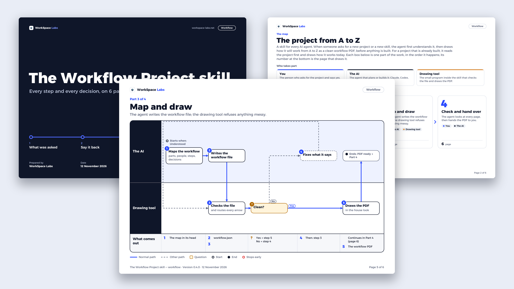

# workflow-project



**Understand a project first. Then hand over how it works, from A to Z.**

An agent skill that makes a project's **workflow**: a clean, professional PDF showing how a new project (or a
new skill) works, before anyone builds it, or how a project that is already built works today. Who does what, every step, every decision, and where a request
stops early. Companies and government offices expect the builder to hand one over; this skill makes the same
document on every agent.

The skill is the folder [`skills/workflow-project/`](skills/workflow-project/): its instructions,
[`SKILL.md`](skills/workflow-project/SKILL.md), and its own drawing tool, so every agent draws the same PDF.

**Version 0.4.0**

---

## What the PDF holds

Every page lies sideways (A4 landscape).

1. **Cover**: the project's name, every part on one path, who it is for, date, version, status.
2. **The map**: what the project is, who takes part, every part as one box with the page it is on, and what
   was assumed and what is still to confirm.
3. **For each part, one page**: a board with one row per person or system and time running across; a blue
   line for the normal path, dashed grey lines for the other paths, an amber box for a question, a red ring
   where it stops early; and under it a strip saying what comes out of every step.

Three pages for a small project, one more for every part. There is no dashboard, no number tiles, no charts.
The look is fixed: the Board look, with one font, Alexandria, for English and Arabic.

**English or Arabic.** Add `"language": "ar"` to the workflow file and the same PDF is drawn in Arabic: the
tool's own words, the month, and every page mirrored to read right to left, with no extra install. Each
language is one small file in `assets/languages/`.

## How it works

1. The agent **understands** the project first: it asks (and, for a built project, reads it first), then
   says it back until the person says yes.
2. It **maps** the workflow into a small JSON file (format: `skills/workflow-project/references/workflow-format.md`).
3. The **drawing tool** checks the file and draws the PDF. It refuses anything messy (a word that does not
   fit, an arrow that would cross a box, a part too big for a page) and says exactly what to change.
4. The agent looks at every page and hands it over.

## Install

The drawing tool needs Python 3.9 or newer and the `reportlab` package (already in Claude's and ChatGPT's
sandboxes; elsewhere `python3 -m pip install reportlab`).

**Claude Code, Codex and other agents**, in one line:

```bash
npx skills add workspace-labs/workflow-project -g
```

Or by hand, for Claude Code:

```bash
git clone https://github.com/workspace-labs/workflow-project.git
mkdir -p ~/.claude/skills
cp -R workflow-project/skills/workflow-project ~/.claude/skills/
```

**Claude app (chat and Cowork)**: make the zip, then upload it in **Customize → Skills**.

```bash
cd workflow-project
rm -f dist/workflow-project.zip && mkdir -p dist
(cd skills && zip -r -X ../dist/workflow-project.zip workflow-project -x '*/__pycache__/*' '*.pyc' '*.DS_Store')
```

**ChatGPT**: where your plan offers **Skills → Create → Upload from your computer**, upload the same zip.
Not tested yet.

Then start a fresh session and ask for a new project, or for the workflow of one you have. The agent asks
its questions first, then hands over the PDF.

## Your own brand

Every PDF carries a name, a logo and a website, WorkSpace Labs by default. They come from one small file,
`skills/workflow-project/assets/brand.json`:

```json
{"name": "WorkSpace Labs", "accent": "Labs", "website": "workspace-labs.net", "logo": "logo-mark.png"}
```

Replace it with your own and put your logo (PNG or JPEG) beside it. `accent` is the one word of the name
drawn in blue (`""` for none); `logo` and `website` may be `""`; the website is written on the cover. The rest of the look (font, colours, layout)
stays the same for everyone. A broken brand file is refused before anything is drawn.

## Run the drawing tool yourself

```bash
python3 skills/workflow-project/scripts/draw_workflow.py skills/workflow-project/examples/building-permit.json -o "Building Permit - Workflow.pdf"
python3 skills/workflow-project/scripts/draw_workflow.py my-workflow.json --check     # checks only
```

## Test

```bash
python3 -m unittest discover -s tests
```

104 checks: the file rules and their plain-language refusals; the drawing's cleanliness (no arrow through a box,
no two arrows touching or crossing, nothing overlapping), judged by `tests/geometry_oracle.py`, which never
imports the tool; every word of accepted PDFs read back with `pdftotext` (skipped where poppler is missing);
the whole PDF (pages, page numbers, fonts); the brand file, including a website too wide for where
the cover draws it (refused in both routes); the command line; and the languages (the same sentences in every
language file, Arabic letters joined and ordered as worked out by hand, the Arabic pages mirrored, clean and
free of overlapping words).

## Limits

- English and Arabic. Other scripts, and Persian or Urdu letters, are refused, not drawn wrong. Arabic vowel
  marks are drawn only roughly centred on their letter. The brand name stays in Latin letters.
- A single word too wide for where it is drawn (a lane name, a box, the cover, the map, the footer) is
  refused with a reason: add a space or shorten it.
- A4 landscape, one page per part: about 8 columns of boxes and up to 5 lanes (with 4 or 5, short titles);
  bigger parts are split. Up to 3 answers per decision.
- Parts on the map follow one another in order.

## Layout

```
skills/workflow-project/     the skill (what gets installed)
  SKILL.md                   what the agent does
  references/                the file format, and the questions to ask first
  scripts/draw_workflow.py   the drawing tool
  scripts/workflow_tool/     its parts (see docs/architecture/boundaries.md)
  examples/                  four complete workflow files, one in Arabic
  assets/                    the font (SIL Open Font License), the languages, brand.json and the logo
tests/                       the checks (not shipped with the skill)
docs/                        scope, architecture, decisions
media/                       the picture at the top of this page
```

## Update every machine

An installed copy does not update itself. After a change lands here, run the install line again on each
machine (or `git pull` in a clone the skill is linked from), then open a fresh session.

## Credits and licence

The code is under the MIT licence (`LICENSE`). Alexandria is by the Alexandria Project Authors, under the SIL Open Font
License 1.1 (see `CREDITS.md`). The logo and the WorkSpace Labs name are WorkSpace Labs' own and are not
covered by the MIT licence; replace them with yours through `assets/brand.json`.

---

<sub>by Workspace Labs</sub>
